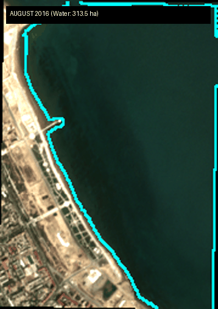
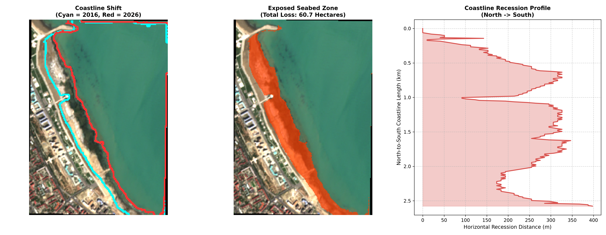

```markdown
# 🌊 Caspian Sea Coastline Recession Analysis (2016–2026)
### Hybrid Geospatial Computer Vision & Zero-Shot Foundation Model Pipeline


An end-to-end geospatial Computer Vision pipeline designed to quantify and visualize the 10-year coastline recession (2016–2026) of the **Caspian Sea along Sumqayit, Azerbaijan**. 

By combining multispectral satellite physics (**Sentinel-2 L2A**), automated spectral prompt engineering (**NDWI**), zero-shot deep learning segmentation (**MobileSAM**), and Euclidean distance geometry, this project converts raw 32-bit satellite reflectance arrays into actionable physical metrics (**hectares of exposed seabed** and **meters of shoreline shift**) entirely on CPU.

<p align="center">
  
</p>

---

## 📊 Key Quantitative Findings (Sumqayit Coastline: 2016 vs. 2026)

Analysis performed over a **~2.6 km coastal sector** in Sumqayit (`EPSG:32639` / UTM Zone 39N, pixel resolution: $10.19\text{ m} \times 10.23\text{ m} = 104.27\text{ m}^2$) reveals severe marine regression over the 10-year period:

| Metric | August 2016 | July 2026 | Net Change / Impact |
| :--- | :---: | :---: | :---: |
| **Total Water Surface Area** | `313.47 ha` | `254.19 ha` | **`-59.28 ha` (-18.9% net water loss)** |
| **Newly Exposed Seabed** | — | — | **`60.71 ha` (`0.607 km²` / ~85 football pitches)** |
| **Mean Perpendicular Recession** | — | — | **`104.0 meters`** |
| **Median Shoreline Shift** | — | — | **`63.3 meters`** |
| **95th Percentile Shift** | — | — | **`267.2 meters`** |
| **Maximum Recession Point** | — | — | **`297.8 meters`** |

<p align="center">
  
</p>

---

## 🧠 Why Hybrid Deep Learning Instead of Simple NDWI Thresholding?

A common question in geospatial analysis is: *"Why not just threshold the Normalized Difference Water Index (NDWI)?"*

1. **Shallow Water Turbidity & Wet Sand:** The Sumqayit shelf is extremely shallow. As the sea recedes, wet sand, algal blooms, wave foam, and suspended sediments create ambiguous spectral signatures near the shore, causing hard pixel-level NDWI thresholds (`NDWI > 0`) to produce fragmented, noisy shorelines.
2. **Contextual Boundary Awareness:** Vision Foundation Models like **MobileSAM (TinyViT)** leverage spatial self-attention and texture gradients across RGB channels to delineate continuous, razor-sharp physical boundaries.
3. **Zero-Human-in-the-Loop Automation:** Standard SAM requires manual user clicks. In this architecture, we use heavily eroded high-confidence **NDWI** regions to automatically generate 100% reliable positive (deep water) and negative (inland urban) spatial prompts, feeding them into **MobileSAM** to resolve the complex coastal boundary.

---

## ⚙️ System Architecture & Methodology

```text
Sentinel-2 L2A GeoTIFFs (32-bit Float: B02, B03, B04, B08)
   │
   ├─► [1. Data Ingestion & Preprocessing]
   │      ├── Affine Transform & CRS Extraction (EPSG:32639, 104.27 m²/px)
   │      └── 2%–98% Percentile Contrast Stretching -> 8-bit Normalized RGB
   │
   ├─► [2. Automated Spectral Prompting]
   │      ├── Compute NDWI = (B03 - B08) / (B03 + B08)
   │      ├── Dynamic Percentile Thresholding (Top 30% Water / Bottom 30% Land)
   │      └── 5x5 Morphological Erosion -> Sample 16 Spatial Point Prompts
   │
   ├─► [3. Zero-Shot Foundation Model Inference]
   │      └── MobileSAM (TinyViT Encoder + Prompt-Guided Mask Decoder on CPU)
   │
   ├─► [4. Post-Processing & Topological Cleaning]
   │      ├── Connected Components Analysis (Isolate Largest Water Body = Caspian Sea)
   │      └── 3x3 Elliptical Morphological Closing (Fill Wave/Rock Voids)
   │
   └─► [5. Geometric & Physical Analytics]
          ├── Bitwise Change Detection: (Mask_2016 == 1) & (Mask_2026 == 0)
          ├── Morphological Gradient Shoreline Extraction
          └── Euclidean Distance Transform (L2 Norm) for Orthogonal Shift Metrics

```

### Mathematical Formulation

* **Normalized Difference Water Index (Auto-Prompter):**

$$\text{NDWI} = \frac{\rho_{\text{Green (B03)}} - \rho_{\text{NIR (B08)}}}{\rho_{\text{Green (B03)}} + \rho_{\text{NIR (B08)}} + \epsilon}$$


* **Shoreline Extraction (Morphological Gradient):**

$$\partial \Omega_{\text{shore}} = M - (M \ominus K_{3\times3})$$


where $M \in \{0, 1\}^{H \times W}$ is the cleaned binary water mask and $\ominus$ denotes morphological erosion.
* **Orthogonal Coastline Recession (Euclidean Distance Transform):**
For every pixel $\mathbf{p} \in \partial \Omega_{2016}$, the shortest physical distance to the 2026 shoreline $\partial \Omega_{2026}$ is computed via:

$$D(\mathbf{p}) = \min_{\mathbf{q} \in \partial \Omega_{2026}} \Vert{}\mathbf{p} - \mathbf{q}\Vert{}_2 \cdot \sqrt{\Delta x \cdot \Delta y}$$


---

## 📁 Repository Structure

```text
caspian-coastline-recession/
├── data/
│   ├── raw/
│   │   ├── 2016/                  # Sentinel-2 L2A GeoTIFF bands (2016-08-19)
│   │   └── 2026/                  # Sentinel-2 L2A GeoTIFF bands (2026-07-23)
│   └── masks/                     # Georeferenced binary water masks (.tif)
├── outputs/                       # Generated analytics dashboards & GIFs
├── notebooks/
│   └── exploration.ipynb          # Interactive R&D and prototyping notebook
├── src/
│   ├── __init__.py
│   ├── data_loader.py             # Rasterio GeoTIFF I/O & percentile normalization
│   ├── segmenter.py               # NDWI Auto-Prompter, MobileSAM & post-processing
│   ├── analytics.py               # Hectare area & Euclidean distance calculations
│   └── visualizer.py              # Matplotlib reporting & animated GIF generator
├── main.py                        # End-to-end execution script
├── requirements.txt               # Project dependencies
└── README.md

```

---

## 🚀 Getting Started

### 1. Clone the Repository & Install Dependencies

```bash
git clone [https://github.com/Ibrahasan/caspian-coastline-recession.git](https://github.com/Ibrahasan/caspian-coastline-recession.git)
cd caspian-coastline-recession
pip install -r requirements.txt

```

### 2. Run the End-to-End Pipeline

Executing `main.py` automatically downloads the lightweight `mobile_sam.pt` weights (~40 MB) on first run, processes the multi-temporal GeoTIFFs on CPU, saves georeferenced masks, prints the quantitative report, and exports all visual assets to `outputs/`:

```bash
python main.py

```

---

## 🛠️ Tech Stack

* **Deep Learning & CV:** `PyTorch`, `Ultralytics (MobileSAM)`, `OpenCV`
* **Geospatial Processing:** `Rasterio`, `Sentinel-2 L2A (Copernicus Data Space)`
* **Scientific Computing & Visualization:** `NumPy`, `Matplotlib`, `Pillow`

---

## 👤 Author

**Ibrahim Hasanov**

*Machine Learning & Computer Vision Engineer*

🔗 [GitHub Profile](https://github.com/Ibrahasan)

```